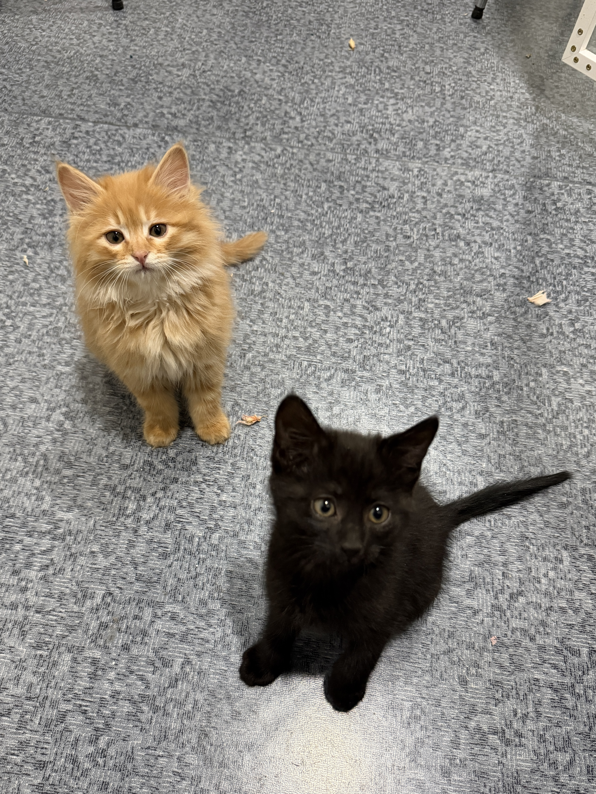

# Mochi & Lucky · Photo Reference / 真猫外貌参考

Creator-provided on 2026-10-20 as `mochi to lucky.jpeg`. The original file is preserved without cropping or color edits and stays outside public preview copies.

Mochi is the orange cat at the back left: fluffy golden-orange fur, pale tabby marks, cream muzzle/chin/chest, pink nose, round eyes, and triangular ears. Lucky is the black cat in the foreground right: dark short fur, large upright ears, yellow-green round eyes, dark nose, and a long slim tail. Preserve these distinguishing features while simplifying the illustration.

Perspective and lighting do not establish true size or exact color. Personality is creator-defined, not inferred from the photograph. Use this photo for appearance, and the visual-style guide for paper, linework, and spacing. Keep existing HTML archives unchanged.

来源：创作者于 2026-10-20 在本次对话提供的 `mochi to lucky.jpeg`。原文件完整复制保存，不裁切、不改色。此图用于角色外貌与长期交接参考；不复制到 `docs/` 公开预览目录。

## 对应关系与外貌锚点

| 角色 | 照片位置 | 可见特征 | 插画中保留 |
| --- | --- | --- | --- |
| Mochi | 左后方橘黄色猫 | 蓬松的橘金色毛，额头与脸颊浅虎斑，浅奶油色口鼻、下巴和胸前毛，粉色鼻子，圆眼与三角耳 | 橘金色、蓬松脸颊和胸毛、浅色口鼻、小粉鼻；线条和色块可简化 |
| Lucky | 右前方黑猫 | 近黑色短毛，较大的直立三角耳，圆而明亮的黄绿色眼睛，小深色鼻子，细长尾巴 | 温黑色身体、醒目的圆眼与黄绿虹膜、大耳朵、细长尾巴 |

照片有前后距离与俯拍透视，不能据此认定两只猫的真实体型比例。毛色与眼色受光线影响，插画沿用低饱和视觉规范。

Mochi 的冷静、理性、dry humor，以及 Lucky 的热情、活泼、容易上头，来自创作者确认的人设；不是从照片推断。照片中的姿势和表情也不是固定人设。

## 接手时怎么用

先看本图辨认两只猫，再读 [Mochi](../mochi.md)、[Lucky](../lucky.md)、[IP Bible](../../brand/IP_BIBLE.md) 与 [视觉规范](../../brand/VISUAL_STYLE.md)。真猫照片负责外貌锚点；独立手绘漫画参考负责纸张、线条与留白方向。后续新画稿逐步吸收这些外貌特征，已有 HTML 版本按原样保留。
